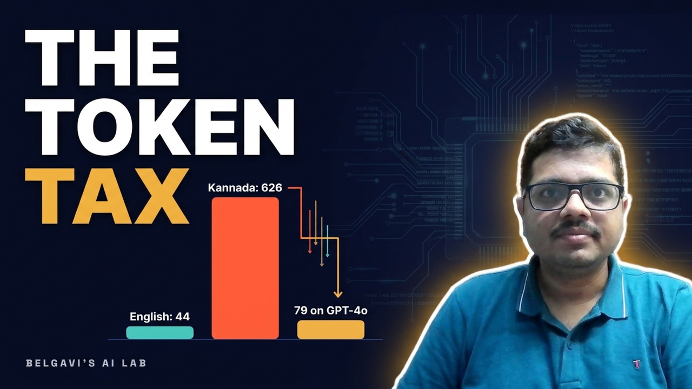

# LLM Engineering, Measured

**Real numbers from real runs, in Java and Python.** Companion code for the *LLM Engineering, Measured* series on [Belgavi's AI Lab](https://www.youtube.com/@belgaviai) on YouTube. By Sandeep Belgavi.

[](https://www.youtube.com/watch?v=HPYAUCQLhBE)

## Episode 1: Kannada Was Always Ready. AI Wasn't (14x → 1.8x tokens)

Two customers of *Belgavi's Book Store*, a fictional online bookstore, ask the same question: *where is my refund?* Jenya writes in English and Tanishka writes in Kannada. The same help-desk paragraph, counted by three generations of OpenAI tokenizers:

| Tokenizer | English | Hindi | Kannada |
|---|---:|---:|---:|
| `r50k_base` (GPT-2 / GPT-3 era) | 44 | 326 | **626 (14.2x)** |
| `cl100k_base` (GPT-4) | 43 | 214 | 405 (9.4x) |
| `o200k_base` (GPT-4o) | 43 | 67 | **79 (1.8x)** |

Same text, same meaning. Kannada went from **14x** the tokens of English on the oldest tokenizer to **under 2x** on GPT-4o, because the newer vocabulary learned Kannada pieces instead of falling back to raw bytes. Measured on a laptop CPU; the Java and Python code print the identical table.

In this episode you will:

- **See tokens:** `Is CASE-1042 fixed?` is 19 characters and 7 tokens.
- **Compare scripts:** the table above, from your own machine.
- **Price an agent run:** a 105-token question becomes 1,185 billed input tokens after 5 tool lookups (11.3x).
- **Avoid a silent bug:** a Java tokenizer that quietly truncates at 512 tokens.

The full walkthrough, with every command and its output, is in **[docs/01-tokens.md](docs/01-tokens.md)**.

## Run it in 60 seconds

**Python** (3.11+):

```bash
git clone https://github.com/Sandeep-BA/belgavis-llm-lab.git
cd belgavis-llm-lab
pip install -e "python[l01]"
python -m belgavi_llm.l01_tokens.fetch       # one small download: three tokenizer files
python -m belgavi_llm.l01_tokens.compare     # the table above
python -m belgavi_llm.l01_tokens --tokenizer cl100k_base tokens "Is CASE-1042 fixed?"
```

**Java** (21+, Maven):

```bash
mvn -B -ntp -q -f java/pom.xml compile exec:java \
  -Dexec.mainClass=dev.belgavi.llm.l01.TokenCli \
  -Dexec.args="compare data/cache/l01/tokenizers"
```

**No setup:** open [`notebooks/01-tokens.ipynb`](notebooks/01-tokens.ipynb) in Google Colab.

Everything runs on CPU, offline after the first download, in under 10 minutes. See [docs/HARDWARE.md](docs/HARDWARE.md) if you want the optional GPU check.

## The series

| # | Episode | Code |
|---|---|---|
| 1 | Tokens: what you are really paying for | **here now** |
| 2 | The transformer, one layer at a time | coming with Episode 2 |
| 3 | Data: dedup, leakage and splits | coming soon |
| 4 | LoRA and QLoRA on an 8 GB GPU | coming soon |
| 5 | Evaluation you can trust | coming soon |
| 6 | Quantization: int8, int4, GGUF | coming soon |
| 7 | GPU memory, measured | coming soon |
| 8 | Serving: KV cache and batching | coming soon |
| 9 | Local inference on a laptop | coming soon |
| 10 | A local model behind a Google ADK agent | coming soon |

Each episode's code lands here on the day the episode goes live. **Watch or star this repo** to get the next one.

## Tests

```bash
pip install -e "python[dev,l01]" && pytest -q python
mvn -B -ntp -f java/pom.xml test
```

## License

MIT, see [LICENSE](LICENSE). The tokenizer files are downloaded from their original sources and keep their own licenses.

Every case, customer and title in this repository is made up. A personal, independent project: views are my own and do not represent any employer, past or present.
