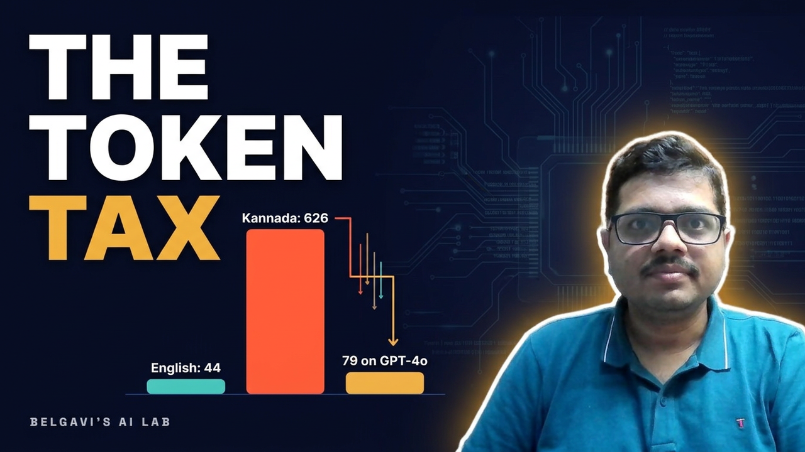

# LLM Engineering, Measured

**Real numbers from real runs, in Java and Python.** Companion code for the *LLM Engineering, Measured* series on [Belgavi's AI Lab](https://www.youtube.com/@belgaviai) on YouTube. By Sandeep Belgavi.

## Episode 3: Your eval is lying (data leakage, JSONL and dedup in Java and Python)

Same data, same model, two scores. On 2,000 synthetic help-desk cases from *Belgavi's Book Store*, a tiny naive-Bayes classifier scores **82.7%** when the data is split by row and **71.6%** when it is split by customer (mean of 10 split seeds). About 11 points came from where the line was drawn, not from the model.

In this episode you will:

- **Write and validate chat-style JSONL:** the validator finds 80 bad rows out of 2,160 (40 with an empty message, 40 with an unknown role), each with its row id and the reason.
- **Clean and de-duplicate:** Unicode NFKC, e-mail masking, then 40 exact and 40 near duplicates removed (MinHash + LSH, confirmed by word 3-gram Jaccard >= 0.7), leaving 2,000 rows from 230 customers.
- **Split by source, not by row:** shuffle the customers, not the rows, so every customer lands on exactly one side.
- **Catch a leak a text check misses:** with the row split, all 400 test rows come from customers seen in training, while exact and near-copy text overlap are both 0.

The data is synthetic and built to behave like repeat-customer help-desk data, so the size of the gap depends on that design. The full walkthrough, with every command and its output, is in **[docs/03-data.md](docs/03-data.md)**.

## Episode 2: What a transformer actually computes (attention by hand, in Java and NumPy)

A tiny model, small enough to check every number by hand: six words, vectors of four numbers, one attention head. For *the cat sat on the*, the Java and Python code print the same tables, stage by stage, and the tests in both languages assert the same fixed values.

In this episode you will:

- **Compute attention by hand:** three tokens and identity matrices give weights `[0.2483, 0.2483, 0.5035]` for the last token, and an output of `[0.7517, 0.7517]`.
- **See the causal mask:** the future gets minus infinity before the softmax, so its weight is exactly 0.
- **Read the output as a distribution:** the untrained toy gives the word *the* 0.2892, and every other word between 0.125 and 0.161.
- **Learn that temperature is one division:** `softmax(logits / T)`; at T=0.25 the top word gets 0.7633, at T=4 only 0.1929.
- **Check NumPy against PyTorch:** layer 0 of a tiny random-weight GPT-2 matches to about 1e-17.

The full walkthrough, with every command and its output, is in **[docs/02-transformer.md](docs/02-transformer.md)**.

[](https://www.youtube.com/watch?v=HPYAUCQLhBE)

## Episode 1: Kannada Was Always Ready. AI Wasn't (14x → 1.8x tokens)

Two customers of *Belgavi's Book Store*, a fictional online bookstore, ask the same question: *where is my refund?* Jenya writes in English and Tanishka writes in Kannada. The same help-desk paragraph, counted by three generations of OpenAI tokenizers:

| Tokenizer | English | Hindi | Kannada |
|---|---:|---:|---:|
| `r50k_base` (GPT-2 / GPT-3 era) | 44 | 326 | **626 (14.2x)** |
| `cl100k_base` (GPT-4) | 43 | 214 | 405 (9.4x) |
| `o200k_base` (GPT-4o) | 43 | 67 | **79 (1.8x)** |

Same text, same meaning. Kannada went from **14x** the tokens of English on the oldest tokenizer to **under 2x** on GPT-4o, because the newer vocabulary learned Kannada pieces instead of falling back to raw bytes. Measured on a laptop CPU; the Java and Python code print the identical table.

In this episode you will:

- **See tokens:** `Is CASE-1042 fixed?` is 19 characters and 7 tokens.
- **Compare scripts:** the table above, from your own machine.
- **Price an agent run:** a 105-token question becomes 1,185 billed input tokens after 5 tool lookups (11.3x).
- **Avoid a silent bug:** a Java tokenizer that quietly truncates at 512 tokens.

The full walkthrough, with every command and its output, is in **[docs/01-tokens.md](docs/01-tokens.md)**.

## Run it in 60 seconds

**Python** (3.11+):

```bash
git clone https://github.com/Sandeep-BA/belgavis-llm-lab.git
cd belgavis-llm-lab
pip install -e "python[l01]"
python -m belgavi_llm.l01_tokens.fetch       # one small download: three tokenizer files
python -m belgavi_llm.l01_tokens.compare     # the table above
python -m belgavi_llm.l01_tokens --tokenizer cl100k_base tokens "Is CASE-1042 fixed?"
```

**Java** (21+, Maven):

```bash
mvn -B -ntp -q -f java/pom.xml compile exec:java \
  -Dexec.mainClass=dev.belgavi.llm.l01.TokenCli \
  -Dexec.args="compare data/cache/l01/tokenizers"
```

**Episode 2, Python** (CPU-only PyTorch, so no CUDA download):

```bash
pip install torch==2.14.1 --index-url https://download.pytorch.org/whl/cpu
pip install -e "python[l02]"
python -m belgavi_llm.l02_transformer.demo   # every stage, the temperature table, the PyTorch check
```

**Episode 2, Java** (no ML library):

```bash
mvn -B -ntp -q -f java/pom.xml compile
java -cp java/target/classes dev.belgavi.llm.l02.Lesson02Demo
mvn -B -ntp -f java/pom.xml test -Dtest=AttentionTest
```

**Episode 3, Python** (standard library only, no download):

```bash
pip install -e "python[dev]"
pytest python/tests/test_l03_data.py                        # 13 passed
python -m belgavi_llm.l03_data.demo --out data/cache/l03    # clean, dedup, split, and the leakage measurement
```

**Episode 3, Java** (Jackson; reads the `raw.jsonl` the Python demo wrote):

```bash
mvn -B -ntp -f java/pom.xml test -Dtest=Lesson03Test
mvn -B -ntp -q -f java/pom.xml compile exec:java   -Dexec.mainClass=dev.belgavi.llm.l03.DatasetBuilder   -Dexec.args="data/cache/l03/raw.jsonl data/cache/l03/java"
```

**No setup:** open [`notebooks/01-tokens.ipynb`](notebooks/01-tokens.ipynb), [`notebooks/02-transformer.ipynb`](notebooks/02-transformer.ipynb) or [`notebooks/03-data.ipynb`](notebooks/03-data.ipynb) in Google Colab.

Everything runs on CPU, offline after the first download, in under 10 minutes. See [docs/HARDWARE.md](docs/HARDWARE.md) if you want the optional GPU check.

## The series

| # | Episode | Code |
|---|---|---|
| 1 | Tokens: what you are really paying for | [docs/01-tokens.md](docs/01-tokens.md) |
| 2 | What a transformer actually computes | [docs/02-transformer.md](docs/02-transformer.md) |
| 3 | Data: dedup, leakage and splits | **here now**: [docs/03-data.md](docs/03-data.md) |
| 4 | LoRA and QLoRA on an 8 GB GPU | coming with Episode 4 |
| 5 | Evaluation you can trust | coming soon |
| 6 | Quantization: int8, int4, GGUF | coming soon |
| 7 | GPU memory, measured | coming soon |
| 8 | Serving: KV cache and batching | coming soon |
| 9 | Local inference on a laptop | coming soon |
| 10 | A local model behind a Google ADK agent | coming soon |

Each episode's code lands here on the day the episode goes live. **Watch or star this repo** to get the next one.

## Tests

```bash
pip install torch==2.14.1 --index-url https://download.pytorch.org/whl/cpu
pip install -e "python[dev,l01,l02]" && pytest -q python
mvn -B -ntp -f java/pom.xml test
```

## License

MIT, see [LICENSE](LICENSE). The tokenizer files are downloaded from their original sources and keep their own licenses.

Every case, customer and title in this repository is made up. A personal, independent project: views are my own and do not represent any employer, past or present.
