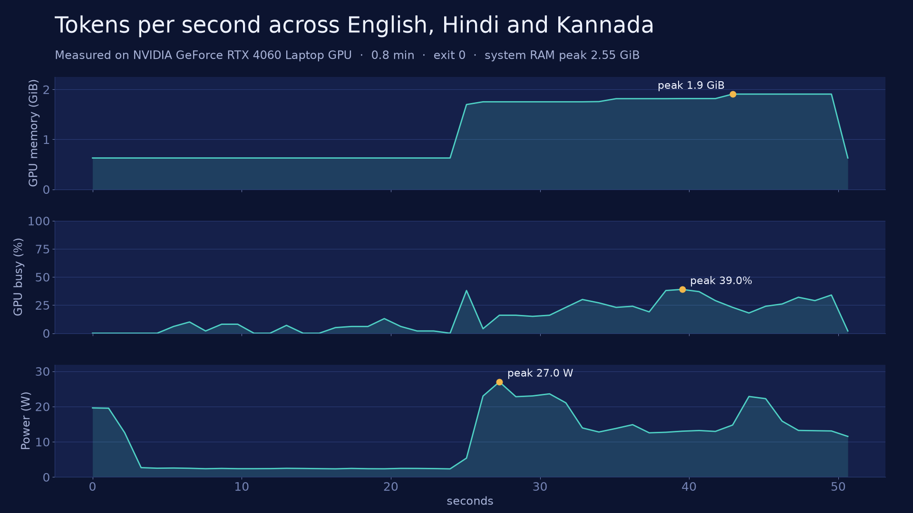

# Lesson 1: Tokens, what you are really paying for

By Sandeep Belgavi.

A model never sees your text. It sees a list of integers called **tokens**, and every limit and every bill is counted in them: the price per call, how much fits in the context window, how long you wait. This lesson shows what a token is, why the same sentence costs 1x in English and up to 14x in Kannada on an older tokenizer, how a context window fills up, and how to estimate the cost of one prompt and of a whole agent run.

Everything here runs offline after one small download, on CPU, in Java and in Python.

## What a token is

A tokenizer turns text into pieces from a fixed vocabulary, and each piece has an id. The three tokenizers in this lesson are byte-level BPE (byte-pair encoding): the vocabulary starts from the 256 possible bytes and adds the merges that were common in the training text. Common English words become one token. Anything the vocabulary never saw falls back to single bytes.

```text
$ python -m belgavi_llm.l01_tokens --tokenizer cl100k_base tokens "Is CASE-1042 fixed?"
text:   Is CASE-1042 fixed?
tokens: 7   characters: 19   utf-8 bytes: 19
ids:    3957 39419 12 6849 17 8521 30
pieces: Is |  CASE | - | 104 | 2 |  fixed | ?
```

Three things to notice: the space belongs to the *next* word (` CASE`), the case number is split into `104` and `2` (digits are chunked), and 19 characters cost 7 tokens. Rule of thumb for English: a token is a few characters. Do not rely on a rule of thumb for money; count.

## The same sentence in three languages

The comparison uses four synthetic help-desk sentences from Belgavi's Book Store, a fictional online bookstore, written once in English, Hindi and Kannada ([`samples.py`](../python/src/belgavi_llm/l01_tokens/samples.py), [`Samples.java`](../java/src/main/java/dev/belgavi/llm/l01/Samples.java)), joined into one paragraph per language. Each cell is the token count, with the cost relative to English in brackets.

Measured 2026-10-26, CPU (Intel Core i9-13900HX laptop, Windows 11, Python 3.13.5), `tokenizers` 0.23.3, command `python -m belgavi_llm.l01_tokens.compare` (the Java CLI prints the identical table):

| tokenizer | English | Hindi | Kannada |
|---|---:|---:|---:|
| r50k_base | 44 (1.0x) | 326 (7.4x) | 626 (14.2x) |
| cl100k_base | 43 (1.0x) | 214 (5.0x) | 405 (9.4x) |
| o200k_base | 43 (1.0x) | 67 (1.6x) | 79 (1.8x) |
| *UTF-8 bytes of the text* | 207 | 555 | 632 |

The three tokenizers are OpenAI's public BPE tables, named as `tiktoken` maps them: `r50k_base` for GPT-3-era models such as `davinci`, `cl100k_base` for `gpt-4` and `gpt-3.5-turbo`, `o200k_base` for `gpt-4o`. They stand for three generations of one design, which is what makes the comparison fair: same algorithm, different vocabulary.

Why the numbers look like this:

- **Bytes are the floor.** Devanagari (Hindi) and Kannada characters take 3 bytes each in UTF-8, so the text is 555 and 632 bytes against English's 207 before any tokenizer has a say.
- **A vocabulary only merges what it saw.** `r50k_base` has almost no Kannada merges, so it emits close to one token per byte: 626 tokens for 632 bytes. `o200k_base` has merges for whole Kannada words and syllables, so 79 tokens.
- **Pieces can split a character.** Look at the tokens for a Hindi sentence on `cl100k_base`: pieces like `<0xE0 0xA4>` are half a character. The model has to learn that two tokens make one letter.

```text
$ python -m belgavi_llm.l01_tokens --tokenizer cl100k_base tokens "टीम एक कार्य दिवस के भीतर उत्तर देगी।"
text:   टीम एक कार्य दिवस के भीतर उत्तर देगी।
tokens: 37   characters: 37   utf-8 bytes: 97
```

**What it means for you:** a Hindi or Kannada prompt can cost several times an English prompt for the same meaning, and it also fills the context window several times faster. The size depends on the model's tokenizer, so measure the tokenizer of the model you will actually call. Counts here are for four short sentences; your texts will differ, which is why the CLI takes any sentence.

Limits of this measurement: four sentences per language, one paragraph each, three tokenizers from one family. It shows the effect and its order of magnitude, not a benchmark of any vendor's model. Qwen2.5, the model the series uses, is measured below the table.

## How a context window fills up

The context window is the most tokens a model can handle in one call, input and output together. It has no memory between calls: in a chat or an agent, **every call resends the whole history**. So:

- A chat turn adds your message plus the model's reply to the history; the next call pays for all of it again.
- The system prompt and the tool schemas ride along on every call. They are paid for every time, even on "hello".
- Reserve room for the answer: a window of 8,192 tokens with 1,024 reserved for output leaves 7,168 for input.

[`cost.py`](../python/src/belgavi_llm/l01_tokens/cost.py) / [`CostModel.java`](../java/src/main/java/dev/belgavi/llm/l01/CostModel.java) give you `ContextWindow` (fits, percent used) and `turns_until_full`.

## Estimating the cost of a prompt and of an agent run

One call: `cost = input_tokens x input_price + output_tokens x output_price`, with prices quoted per million tokens. **Prices are an input to the calculator, not data in this repo.** The examples use a deliberately fake `EXAMPLE_PRICING` of $1.00 in / $4.00 out per million tokens so the numbers are reproducible. Take real prices from your provider's current price page, and count with *that model's* tokenizer.

An agent run is several calls (ADK series: model, tool, model, ...). Call *n* is billed for the prefix (system prompt + tool schemas + user message) plus every output and tool result of calls 1 to n-1. Input therefore grows with every step, and the total grows faster than the number of steps.

Worked example, five case lookups then a final answer (synthetic Belgavi's Book Store help-desk texts from [`__main__.py`](../python/src/belgavi_llm/l01_tokens/__main__.py)), measured with `cl100k_base`:

```text
$ python -m belgavi_llm.l01_tokens --tokenizer cl100k_base agent --lookups 5
prefix (system + tool schema + user): 105 tokens
  call 1 input: 105 tokens
  call 2 input: 142 tokens
  call 3 input: 179 tokens
  call 4 input: 216 tokens
  call 5 input: 253 tokens
  call 6 input: 290 tokens
total input billed: 1185   output: 103
billed input is 11.3x the 105-token first prompt
peak context: 313 of 8192 (3.82%)
cost at EXAMPLE price ($1.0/M in, $4.0/M out, not a real vendor): $0.001597
chat turns of 42 tokens before the window is full: 168
```

You wrote 105 tokens; you paid for 1,185 input tokens. With one lookup the same run bills 2.4x the prefix; the multiplier grows with every tool call and with every large tool result. Provider-side prompt caching can discount a repeated prefix, but how much depends on the provider, so this lesson counts the plain case and does not model it.

## Run it: three tiers

Pinned for this lesson (checked on 2026-10-22):

| Library | Version | Source |
|---|---|---|
| Hugging Face `tokenizers` (Python) | 0.23.3 | https://pypi.org/project/tokenizers/0.23.3/ |
| `tiktoken` (Python, parity test only) | 0.14.0 (MIT) | https://pypi.org/project/tiktoken/0.14.0/ |
| DJL `ai.djl.huggingface:tokenizers` (Java) | 0.39.0 | https://repo1.maven.org/maven2/ai/djl/huggingface/tokenizers/0.39.0/ |
| `jtokkit` jar, only as the source of the three vocabularies | 1.1.0 (MIT, from its POM) | https://repo1.maven.org/maven2/com/knuddels/jtokkit/1.1.0/ |
| `transformers` + `torch`, GPU step only | `transformers` 5.20.2 | https://pypi.org/project/transformers/5.20.2/ |

Java 21, Maven 3.9, Python 3.11+.

### One-time setup (all tiers): fetch the tokenizers

The vocabularies are not stored in git. `fetch` downloads the `jtokkit` jar from Maven Central, checks its SHA-256, checks each table against the hashes that `tiktoken` itself pins, and converts each table into a Hugging Face `tokenizer.json` that both `tokenizers` and DJL load. The result goes to `data/cache/l01/tokenizers/` (git-ignored). The converted files give the same ids as `tiktoken` on the lesson texts; `test_converted_tokenizer_matches_tiktoken` checks it.

```sh
python -m venv .venv && source .venv/bin/activate
pip install -e "python[dev,l01]"
python -m belgavi_llm.l01_tokens.fetch --keep-jar
```

```text
wrote data/cache/l01/tokenizers/r50k_base.json (50256 tokens)
wrote data/cache/l01/tokenizers/cl100k_base.json (100256 tokens)
wrote data/cache/l01/tokenizers/o200k_base.json (199998 tokens)
```

Need a different tokenizer, e.g. the Qwen model this series uses? Any `tokenizer.json` works: `compare --extra name=path`, `tokens --tokenizer-file path` (Python), or pass the path to the Java CLI.

### Tier 1: CPU only (any laptop, no GPU)

Measured on 4 cores, 16 GB RAM, no GPU, Linux x86_64, Python 3.11.17, OpenJDK 21.0.12, Maven 3.9.11, 2026-10-22. The whole CPU path (fetch, compare, tokens, agent cost) took **6 s in Python and 6 s in Java** with a warm Maven cache; first-time Maven downloads add whatever your network needs. The 10-minute budget is far from tight.

```sh
make l01-cpu                          # fetch, Python compare, Java compare
python -m belgavi_llm.l01_tokens agent --lookups 5
mvn -B -ntp -f java/pom.xml test      # Java tests, offline once dependencies are cached
pytest -q python                      # Python tests (`download`-marked ones need the fetch above)
```

The Java CLI, from the repository root (set `LC_ALL=C.UTF-8` if Hindi or Kannada arguments arrive garbled; the JVM decodes arguments with the OS locale):

```sh
mvn -B -ntp -q -f java/pom.xml compile exec:java \
  -Dexec.mainClass=dev.belgavi.llm.l01.TokenCli \
  -Dexec.args="tokens data/cache/l01/tokenizers/cl100k_base.json 'Is CASE-1042 fixed?'"
```

```text
text:   Is CASE-1042 fixed?
tokens: 7   characters: 19   utf-8 bytes: 19
ids:    3957 39419 12 6849 17 8521 30
pieces: Is |  CASE | - | 104 | 2 |  fixed | ?
```

Same ids as Python. Other commands: `compare data/cache/l01/tokenizers`, `agent data/cache/l01/tokenizers/cl100k_base.json 5`, and `tokens <file> -` to read the sentence from stdin as UTF-8.

Measured CPU test run: Java 21 tests, `BUILD SUCCESS` in about 4 s; Python 29 passed, 1 skipped (the GPU test), in about 2 s.

### Tier 2: GPU (NVIDIA, 8 GB; Windows through WSL2)

Tokenizing needs no GPU. The GPU step measures the other side of a token: how many tokens per second a model reads (prefill) and writes (decode). Native Windows is not supported for the later vLLM lessons; use WSL2 so the whole series has one setup.

```sh
make setup-gpu                        # CUDA PyTorch, see the Makefile
pip install "transformers==5.20.2"
python -m belgavi_llm.l01_tokens.gpu_throughput --model Qwen/Qwen2.5-0.5B-Instruct
```

Without a CUDA GPU the script prints `GPU step skipped: ...` and exits 0; its test is skipped cleanly. Model: `Qwen/Qwen2.5-0.5B-Instruct`, Apache-2.0 and 494,032,768 parameters per its Hugging Face model card (checked 2026-10-30).

### Tier 3: free cloud GPU (Colab or Kaggle)

Open [`notebooks/01-tokens.ipynb`](../notebooks/01-tokens.ipynb), choose a GPU runtime, run all cells. Steps 1 to 3 are the CPU path; step 4 is the GPU step above. The notebook clones this repository.

## More measurements

**Qwen2.5's tokenizer on the same paragraph** (measured 2026-10-30, same laptop, `tokenizers` 0.23.3, command `python -m belgavi_llm.l01_tokens.compare --extra qwen2.5=qwen2.5-tokenizer.json` after `curl -L -o qwen2.5-tokenizer.json https://huggingface.co/Qwen/Qwen2.5-0.5B-Instruct/resolve/main/tokenizer.json`):

| tokenizer | English | Hindi | Kannada |
|---|---:|---:|---:|
| qwen2.5 | 43 (1.0x) | 201 (4.7x) | 314 (7.3x) |

**Throughput on an RTX 4060** (measured 2026-10-23, re-measured 2026-10-27 with the current sample sentences): `gpu_throughput` gives English 43 prompt tokens / 81.8 ms prefill / 16.3 tok/s decode, Hindi 201 / 71.4 ms / 16.0, Kannada 314 / 78.6 ms / 17.9. The GPU averaged 14% busy, so plain `transformers.generate` is overhead-bound here.



## Where things are

| Piece | Python | Java |
|---|---|---|
| Convert and cache tokenizers | `l01_tokens/fetch.py` | (uses the Python output) |
| Count, pieces, bytes | `l01_tokens/counting.py` | `TokenCounter.java` |
| Context window, price, agent run | `l01_tokens/cost.py` | `CostModel.java` |
| Language comparison table | `l01_tokens/compare.py` | `TokenCli compare` |
| CLI | `python -m belgavi_llm.l01_tokens` | `TokenCli` |
| Offline test tokenizer | `testdata/l01/toy-tokenizer.json`, shared by both languages | |

Why Java uses a file produced by Python: the vocabularies ship as `tiktoken` tables, a format Java's Hugging Face binding cannot read, and the conversion is a one-off step. After it, Java and Python load the same `tokenizer.json` and agree id for id.

Two traps found while building this lesson:

1. **Silent truncation.** DJL's `HuggingFaceTokenizer` truncates to 512 tokens by default. A first Java run counted 512 tokens for a 607-token text (the r50k_base Kannada paragraph of an earlier version of the samples) without any warning. `TokenCounter` turns truncation off and a test guards it. If you count tokens with a library, check its defaults.
2. **Argument decoding.** Non-ASCII command-line arguments to Java depend on the OS locale. Use `LC_ALL=C.UTF-8` or the `-` (stdin) form.

## Check yourself

1. Why does a space belong to the following word in `cl100k_base`?
2. A tool returns a 2,000-token JSON blob on every call. How many input tokens does a 4-call run pay for that blob alone?
3. Which tokenizer would you pick to compare the cost of a Kannada prompt across two models, and what would you measure?
